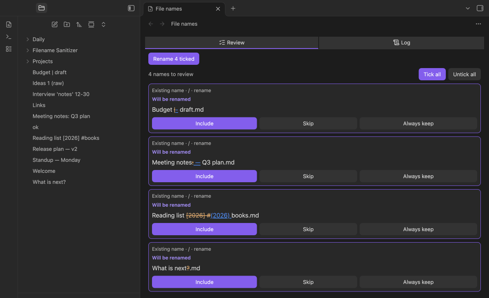
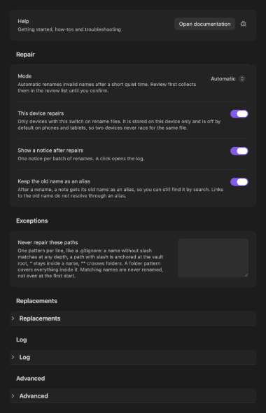
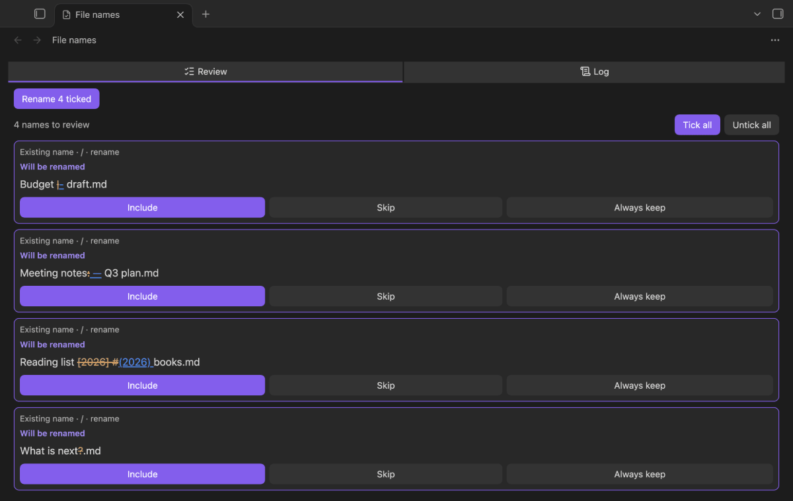
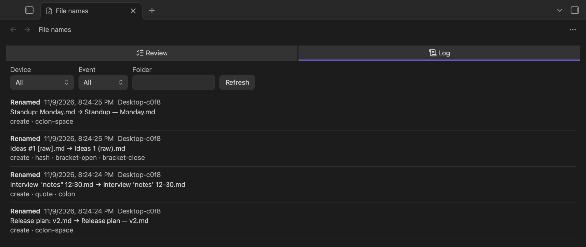

# Filename Sanitizer

> [🇬🇧 English](README.md) · 🇩🇪 Deutsch

**Repariert Dateinamen, die Obsidian Sync oder Links ablehnen, sagt kurz Bescheid, protokolliert jede Änderung und bietet schreibenden Plugins eine Namens-API.**

LLMs, Skripte und andere Werkzeuge legen Dateien an, deren Namen Zeichen enthalten, die Obsidian Sync am Handy ablehnt (`: ? * " < > | # ^ [ ]`) oder die Links brechen. Filename Sanitizer benennt solche Dateien nach festen, einstellbaren Regeln um, lässt die Links mitgehen, protokolliert jede Änderung mit allem, was beim Finden des Schreibers hilft, und bleibt dir aus dem Weg. Er überschreibt nie und löscht nie eine Datei.

## Funktionen

- **Automatische Reparatur nach einer Ruhezeit** — eine neue Datei mit ungültigem Namen wird erst geprüft, wenn sie 5 Sekunden (einstellbar) unverändert blieb, damit ein Schreiber, der noch arbeitet, seine Datei behält. Ordner kommen vor ihrem Inhalt dran.
- **Regeln, die du ändern kannst** — jedes ungültige Zeichen hat eine eigene Ersetzung (`vault-crews: Status` wird `vault-crews — Status`, `12:30` wird `12-30`, `ids[0]` wird `ids(0)`). Auch Leerzeichen und Punkte am Rand, Steuerzeichen und Namen, die leer würden, werden behandelt. Eine Ersetzung, die selbst ungültig ist, wird abgelehnt und benannt.
- **Links gehen mit** — das Plugin benennt mit Obsidians eigenem Dateimanager um, daher werden Links auf die Datei angepasst. Der alte Name bleibt als Alias in der Notiz (abschaltbar).
- **Nie eine Kollision** — existiert der Zielname mit gleichem Inhalt, bleibt die Datei liegen und wird als Dublette markiert; bei anderem Inhalt wird eine Nummer angehängt (`a — b 2.md`). Ein Ordner wird nie zusammengeführt.
- **Prüfliste** — je Vault wählst du zwischen *Automatisch* und *Erst bestätigen*. In *Erst bestätigen* und für alles, was das Plugin nicht von selbst tun darf, zeigt eine Liste mit altem und neuem Namen, was sich ändern würde; du hakst an, ab oder sagst *Immer so lassen*.
- **Vorhandene Namen bleiben unberührt** — beim ersten Start auf einem Gerät wird nichts umbenannt. Bestehende Namen erscheinen in der Prüfliste; nur Namen, die später entstehen, werden automatisch repariert. Das gilt auch, wenn erst eine Regeländerung einen vorhandenen Namen ungültig macht: er kommt in die Prüfliste.
- **Protokoll** — eine `.jsonl`-Datei je Gerät und Monat in einem Ordner deines Vaults, mit Herkunft, Wirkung, Umgebung und gewählten Frontmatter-Feldern; der Anfang des Notiztextes ist optional und vorab aus. Die Ansicht zeigt es neueste zuerst, filterbar nach Gerät, Ordner und Ereignis.
- **Plugin-API für Schreiber** — `app.plugins.plugins["filename-sanitizer"].api` bietet `sanitizeName` und `checkName` (synchron). Plugins, die Dateien schreiben, fragen sie zuerst und fallen ohne sie auf dieselben Standardregeln zurück, über `safeFileName` in `obsidian-kit`.
- **Ein Popup je Schub** — ein Klick öffnet das Protokoll. Abschaltbar.

## Voraussetzungen

- **Obsidian 1.15.0+**, Desktop und Mobil. Auf Handy und Tablet benennt das Plugin vorab nicht um (Schalter *Dieses Gerät repariert*), damit zwei Geräte nicht um dieselbe Datei wetteifern; Einstellungen, Protokoll und API laufen überall.
- **Das automatische Umbenennen braucht die Obsidian-Einstellung *Dateien und Links → Interne Links automatisch aktualisieren* eingeschaltet.** Sonst öffnet Obsidian für jede Datei mit Backlinks einen Dialog, und alle weiteren Umbenennungen warten dahinter. Ist die Einstellung aus, benennt das Plugin nicht von selbst um und füllt die Prüfliste. Es ändert diese Einstellung nie.
- Das Plugin stellt keine Netzwerkanfragen.

## Installation

### Über Obsidians Community-Plugins

Sobald das Plugin den Store-Review bestanden hat: **Einstellungen → Community-Plugins → Durchsuchen**, nach *Filename Sanitizer* suchen, **Installieren**, **Aktivieren**.

### Manuell

Lade `main.js`, `manifest.json` und `styles.css` vom [neuesten Release](https://github.com/johannes-kaindl/filename-sanitizer/releases/latest) herunter, kopiere sie in den Ordner `filename-sanitizer` im Plugin-Ordner deines Vaults (`<Vault>/.obsidian/plugins/`) und schalte das Plugin unter **Einstellungen → Community-Plugins** ein.

### Mit BRAT

Füge `johannes-kaindl/filename-sanitizer` im Plugin BRAT als Beta-Plugin hinzu.

## Benutzung

Beim ersten Einschalten auf einem Gerät wird nichts umbenannt: Namen, die schon gegen die Regeln verstoßen, warten in der Prüfliste. Danach wird eine neue Datei mit ungültigem Namen nach der Ruhezeit repariert, und ein Popup sagt, was geschehen ist.

- **Prüfliste und Protokoll öffnen** (Befehlspalette) öffnet die Ansicht mit den Tabs *Prüfen* und *Protokoll*.
- **Dateinamen jetzt prüfen** durchsucht den Vault erneut und füllt die Prüfliste.
- In der Prüfliste hakst du an, ab oder sagst *Immer so lassen* und drückst dann **Angehakte umbenennen**.

Schritt für Schritt: [Erste Schritte](https://github.com/johannes-kaindl/filename-sanitizer/blob/main/docs/getting-started.md).

## Konfiguration

Einstellungen → Filename Sanitizer. Zuerst kommt die Hilfe, dann die Gruppen *Reparatur* und *Ausnahmen* und drei eingeklappte Gruppen.

- **Reparatur** — Betriebsart (*Automatisch* oder *Erst bestätigen*), *Dieses Gerät repariert* (an auf Desktops, aus auf Handy und Tablet, nur auf dem Gerät gespeichert), Gerätename, das Popup nach Reparaturen und der alte Name als Alias (nur Markdown-Notizen).
- **Ausnahmen** — Pfade, die nie repariert werden, ein Muster je Zeile, geschrieben wie eine `.gitignore`.
- **Ersetzungen** — was jedes ungültige Zeichen ersetzt; leer entfernt es. Eine Ersetzung, die selbst ungültig ist, wird abgelehnt.
- **Protokoll** — Ordner (vorab `Filename Sanitizer/Log`), Aufbewahrung in Monaten (vorab 12, 0 behält alles) und welche Felder in jede Zeile kommen.
- **Erweitert** — Ruhezeit (vorab 5000 ms), zusätzliche ungültige Zeichen und eine größte Namenslänge in Bytes.

 Der ganze Tab (Klick für die volle Größe)

## Funktionsweise

Das Plugin beobachtet neue und umbenannte Dateien. Eine Datei wird erst geprüft, wenn sie die Ruhezeit lang unverändert blieb, eine Umbenennung nach der anderen, Ordner vor ihrem Inhalt. Es benennt mit Obsidians eigenem Dateimanager um, daher gehen Links auf die Datei mit, und schreibt eine Zeile ins Protokoll. Ein vorhandener Name wird nie überschrieben: bei gleichem Inhalt bleibt die Datei als markierte Dublette liegen, bei anderem Inhalt bekommt sie eine Nummer. Nichts wird je gelöscht.

Was das Plugin nicht allein tun darf, geht in die Prüfliste: Namen, die vor dem ersten Start auf einem Gerät bestanden oder erst durch eine Regeländerung ungültig wurden, Namen, die immer wiederkommen, und alle Namen, solange in Obsidian „Interne Links automatisch aktualisieren“ aus ist.

### Grenzen

- **Das automatische Umbenennen braucht die Obsidian-Einstellung *Dateien und Links → Interne Links automatisch aktualisieren* eingeschaltet.** Sonst öffnet Obsidian für jede Datei mit Backlinks einen Dialog, und alle weiteren Umbenennungen warten dahinter. Ist die Einstellung aus, benennt das Plugin nicht von selbst um und füllt die Prüfliste. Es ändert diese Einstellung nie.
- Ein Name mit Rückwärts-Schrägstrich (`\`) ist für Obsidian unsichtbar (nicht im Index, kein Ereignis); das Plugin kann ihn nicht reparieren.
- Dateien jeder Endung werden automatisch umbenannt, solange in Obsidian „Interne Links automatisch aktualisieren“ an ist.
- Ob Obsidian Sync jedes Zeichen der Standardtabelle auf jedem Gerät annimmt, wie genau ein Rennen zweier Desktops ausgeht und ob Sync die Protokolldatei mitnimmt, lässt sich nur an einem echten Konto messen; siehe [Fehlersuche](https://github.com/johannes-kaindl/filename-sanitizer/blob/main/docs/troubleshooting.md).

## Dokumentation

- [Dokumentationsübersicht](https://github.com/johannes-kaindl/filename-sanitizer/blob/main/docs/README.md) — alle Anleitungen an einem Ort.
- [Erste Schritte](https://github.com/johannes-kaindl/filename-sanitizer/blob/main/docs/getting-started.md) — was nach dem Einschalten geschieht und wie du Prüfliste und Protokoll benutzt.
- [Fehlersuche](https://github.com/johannes-kaindl/filename-sanitizer/blob/main/docs/troubleshooting.md) — warum eine Datei nicht umbenannt wurde und was das Plugin nicht kann.

## Lizenz

Code: AGPL-3.0-or-later ([LICENSE](LICENSE)). Dokumentation: CC BY-SA 4.0 ([LICENSE-DOCS](LICENSE-DOCS)). Dual-License-Option: [LICENSING.md](LICENSING.md).
