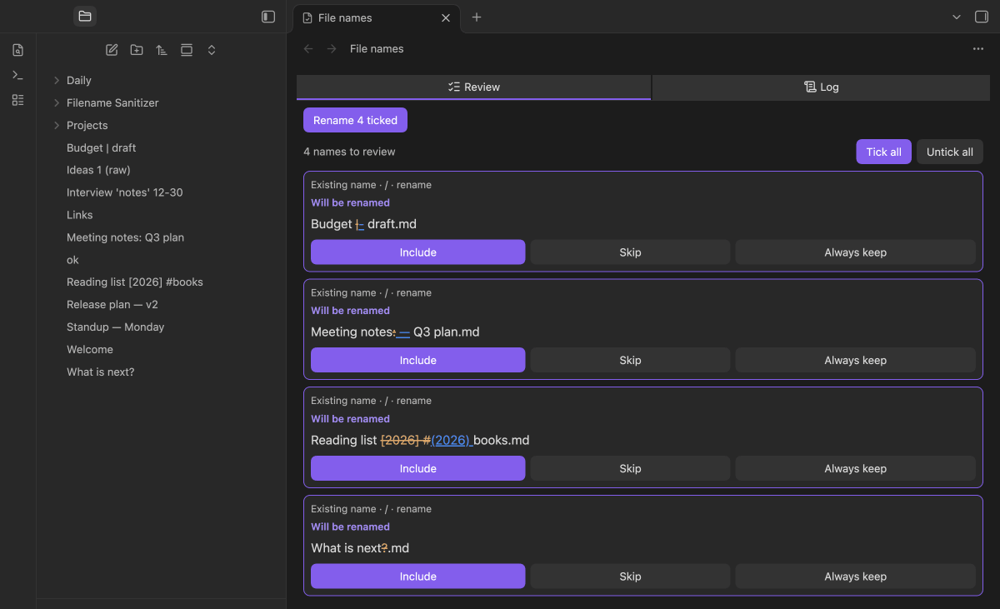
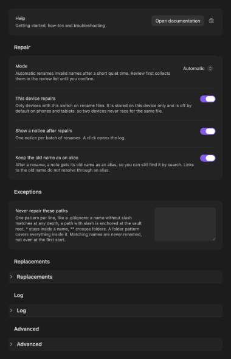
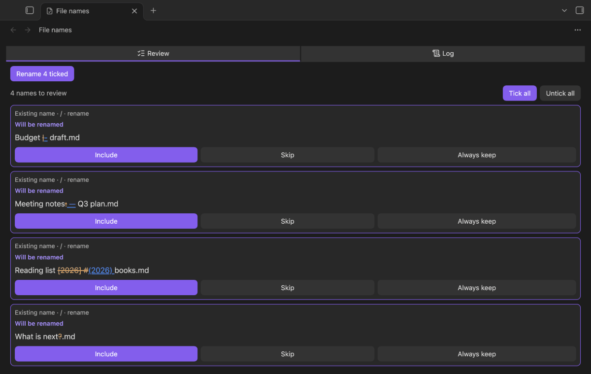
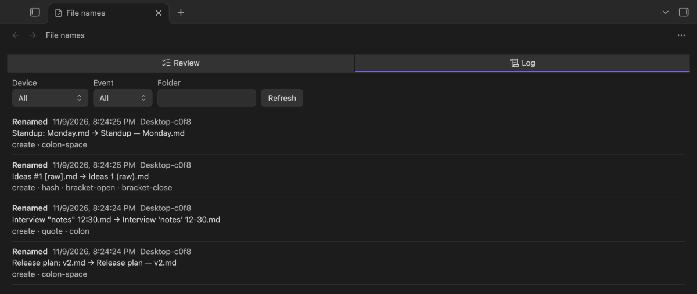

# Filename Sanitizer

> 🇬🇧 English · [🇩🇪 Deutsch](README.de.md)

**Repairs file names that Obsidian Sync or links reject, tells you briefly, keeps a log of every change and offers writing plugins a name API.**

LLMs, scripts and other tools create files whose names contain characters that Obsidian Sync on a phone refuses (`: ? * " < > | # ^ [ ]`), or that break links. Filename Sanitizer renames such files by fixed, adjustable rules, lets links follow, logs every change with everything that helps you find the writer, and stays out of your way. It never overwrites and never deletes a file.

## Features

- **Automatic repair after a quiet time** — a new file with an invalid name is checked only after it has not changed for 5 seconds (adjustable), so a writer that is still working keeps its file. Folders are repaired before their contents.
- **Rules you can change** — each invalid character has its own replacement (`vault-crews: Status` becomes `vault-crews — Status`, `12:30` becomes `12-30`, `ids[0]` becomes `ids(0)`). Leading and trailing spaces and dots, control characters and names that would end up empty are handled as well. A replacement that is itself invalid is refused and named.
- **Links go with the file** — the plugin renames with Obsidian's own file manager, so links to the file are updated. The old name is kept as an alias in the note (switchable).
- **Never a collision** — if the target name exists with identical content, the file stays and is marked as a duplicate; with different content a number is appended (`a — b 2.md`). A folder is never merged.
- **Review list** — choose per vault between *Automatic* and *Review first*. In *Review first*, and for everything the plugin must not do on its own, a list with old and new name shows what would change; you tick, untick or say *Always keep*.
- **Existing names stay untouched** — at the first start on a device nothing is renamed. Names that already exist appear in the review list; only names that appear later are repaired automatically. The same holds when a change of the rules makes an existing name invalid: it goes to the review list.
- **Log** — one `.jsonl` file per device and month in a folder of your vault, with origin, effect, environment and chosen front matter fields; the start of the note text is optional and off by default. The view shows it newest first, filterable by device, folder and event.
- **Plugin API for writers** — `app.plugins.plugins["filename-sanitizer"].api` offers `sanitizeName` and `checkName` (synchronous). Plugins that write files ask it first and fall back to the same default rules without it, through `safeFileName` in `obsidian-kit`.
- **One notice per batch** — a click opens the log. It can be switched off.

## Requirements

- **Obsidian 1.15.0+**, desktop and mobile. On phones and tablets the plugin does not rename by default (switch *This device repairs*), so two devices never race for the same file; settings, log and API work everywhere.
- **Automatic renaming needs the Obsidian setting *Files and links → Automatically update internal links* on.** Otherwise Obsidian opens a dialog for every file that has backlinks and all further renames wait behind it. With the setting off the plugin renames nothing on its own and fills the review list. It never changes that setting.
- The plugin makes no network requests.

## Install

### From Obsidian's Community plugins browser

Once the plugin has passed the store review: **Settings → Community plugins → Browse**, search for *Filename Sanitizer*, **Install**, **Enable**.

### Manually

Download `main.js`, `manifest.json` and `styles.css` from the [latest release](https://github.com/johannes-kaindl/filename-sanitizer/releases/latest), copy them into the folder `filename-sanitizer` inside your vault's plugin folder (`<vault>/.obsidian/plugins/`) and enable the plugin under **Settings → Community plugins**.

### With BRAT

Add `johannes-kaindl/filename-sanitizer` as a beta plugin in the BRAT plugin.

## Usage

The first time you enable the plugin on a device nothing is renamed: names that already break the rules wait in the review list. From then on a new file with an invalid name is repaired after the quiet time and a notice says what happened.

- **Open review and log** (command palette) opens the view with the tabs *Review* and *Log*.
- **Check file names now** scans the vault again and fills the review list.
- In the review list you tick, untick or say *Always keep*, then press **Rename ticked**.

Step by step: [Getting started](https://github.com/johannes-kaindl/filename-sanitizer/blob/main/docs/getting-started.md).

## Configuration

Settings → Filename Sanitizer. Help comes first, then the groups *Repair* and *Exceptions* and three collapsed groups.

- **Repair** — mode (*Automatic* or *Review first*), *This device repairs* (on for desktops, off for phones and tablets, stored on the device only), device name, the notice after repairs and the old name as an alias (Markdown notes only).
- **Exceptions** — paths that are never repaired, one pattern per line, written like a `.gitignore`.
- **Replacements** — what replaces each invalid character; empty removes it. A replacement that is itself invalid is refused.
- **Log** — folder (default `Filename Sanitizer/Log`), retention in months (default 12, 0 keeps everything) and which fields go into each line.
- **Advanced** — quiet time (default 5000 ms), additional invalid characters and a maximum name length in bytes.

 The whole tab (click for full size)

## How it works

The plugin watches for new and renamed files. A file is checked only after it has not changed for the quiet time, one rename at a time, folders before their contents. It renames with Obsidian's own file manager, so links to the file follow, and writes one line to the log. A name that exists is never overwritten: identical content leaves the file as a marked duplicate, different content gets a number. Nothing is ever deleted.

What the plugin must not do alone goes to the review list: names that existed before the first start on a device or became invalid through a change of the rules, names that keep coming back, and all names while Obsidian's *Automatically update internal links* is off.

### Limits

- **Automatic renaming needs the Obsidian setting *Files and links → Automatically update internal links* on.** Otherwise Obsidian opens a dialog for every file that has backlinks and all further renames wait behind it. With the setting off the plugin renames nothing on its own and fills the review list. It never changes that setting.
- A name containing a backslash (`\`) is invisible to Obsidian (not in its index, no event); the plugin cannot repair it.
- Files of every extension are renamed automatically, as long as *Automatically update internal links* is on.
- Whether Obsidian Sync accepts every character of the default table on every device, the exact behaviour of a race between two desktops and whether Sync carries the log file are measured on a real account only; see [troubleshooting](https://github.com/johannes-kaindl/filename-sanitizer/blob/main/docs/troubleshooting.md).

## Documentation

- [Documentation index](https://github.com/johannes-kaindl/filename-sanitizer/blob/main/docs/README.md) — all guides in one place.
- [Getting started](https://github.com/johannes-kaindl/filename-sanitizer/blob/main/docs/getting-started.md) — what happens after you enable the plugin, and how to use the review list and the log.
- [Troubleshooting](https://github.com/johannes-kaindl/filename-sanitizer/blob/main/docs/troubleshooting.md) — why a file was not renamed, and what the plugin cannot do.

## License

Code: AGPL-3.0-or-later ([LICENSE](LICENSE)). Documentation: CC BY-SA 4.0 ([LICENSE-DOCS](LICENSE-DOCS)). Dual-license option: [LICENSING.md](LICENSING.md).
